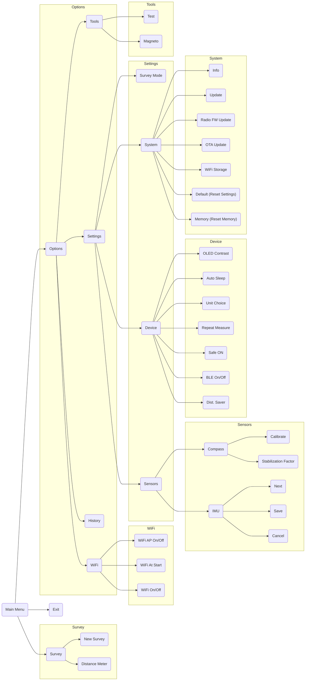

# Menus Overview

This document provides a visual representation of the JedEye menu structure, with each menu's entries in the order
the JedEye shows them. On the screen a setting shows its current value next to its name, such as **UNIT (m)** or
**WIFI START (OFF)**. **OTA Update** is on firmware v2.6 and newer, **WiFi Storage** on firmware v2.9.6 and newer.

## Main Menu Structure

